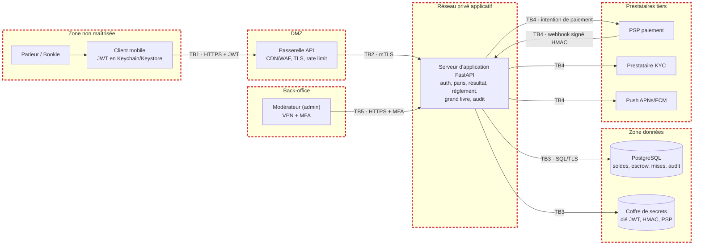

# Architecture et frontières de confiance

Les cadres rouges en pointillés délimitent les zones ; chaque flux qui traverse un cadre franchit une frontière de confiance.

## Frontières de confiance

| ID | Frontière |
|---|---|
| TB1 | Smartphone de l'utilisateur <-> passerelle API (Internet, appareil non maîtrisé) |
| TB2 | Passerelle/WAF <-> serveur d'application (réseau privé) |
| TB3 | Serveur d'application <-> zone données (BDD, coffre de secrets) |
| TB4 | Plateforme <-> prestataires tiers (PSP de paiement, KYC, notifications push) |
| TB5 | Back-office modérateur <-> API (accès privilégié, VPN + MFA) |

## Données sensibles

| Donnée | Emplacement / protection |
|---|---|
| Secrets (clé JWT, clé HMAC d'audit, secret webhook PSP, clés API PSP/KYC) | Gestionnaire de secrets / KMS, injectés en variables d'environnement ; jamais dans le code ni l'app mobile |
| Soldes utilisateurs et fonds séquestrés | BDD : grand livre ledger_entries (comptes user:*, escrow:*, platform, psp) ; les fonds réels sont chez le PSP |
| Mises, reçus, votes | BDD : tables wagers, result_votes |
| Mots de passe | BDD : hash Argon2id uniquement |
| Journal d'audit | BDD audit_log chaîné + export WORM (prévu) |
| Données d'identité (KYC), IBAN, carte | Chez les prestataires KYC/PSP ; la plateforme ne garde qu'un statut / jeton |
| Jeton de session | Smartphone : Keychain (iOS) / Keystore (Android) |
